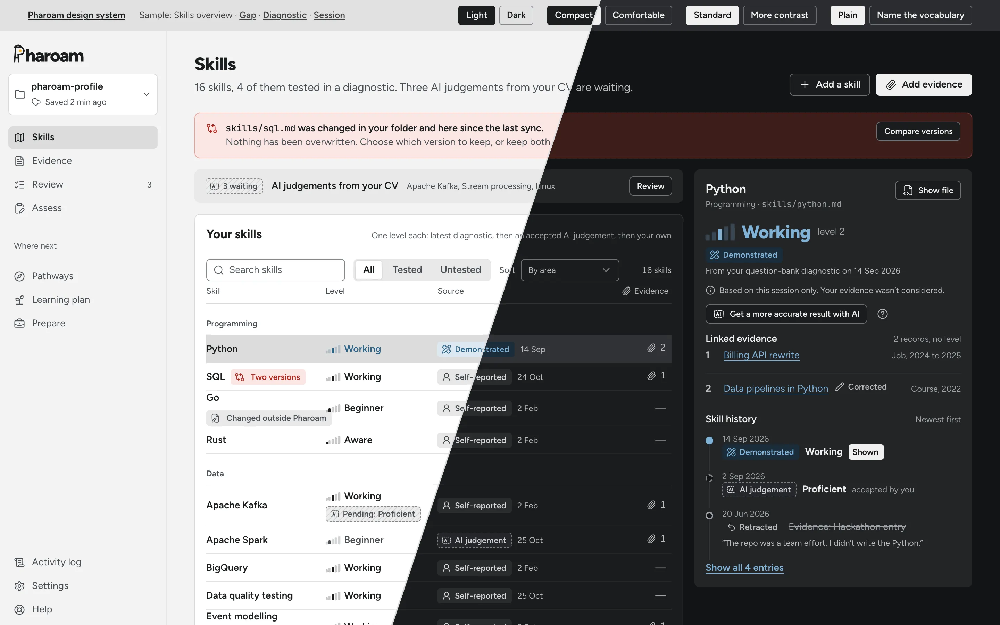
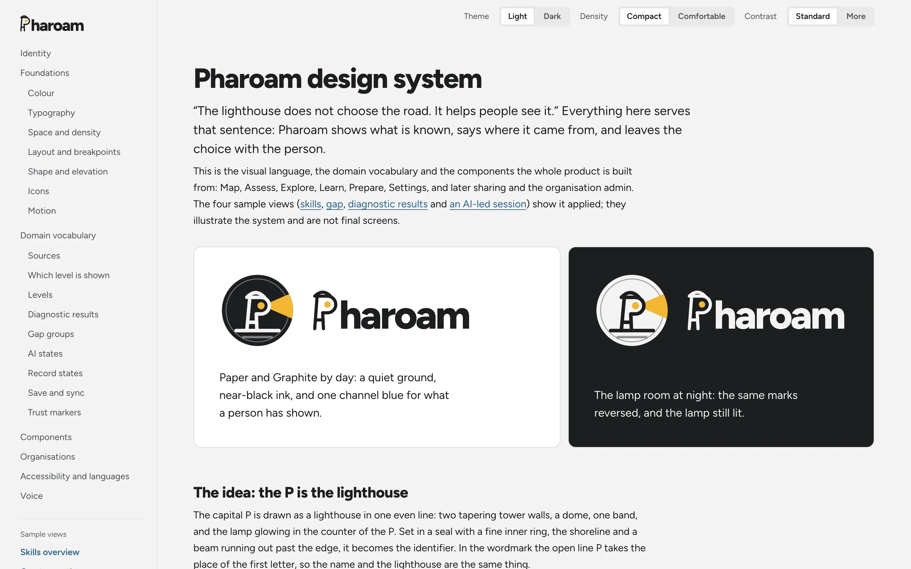
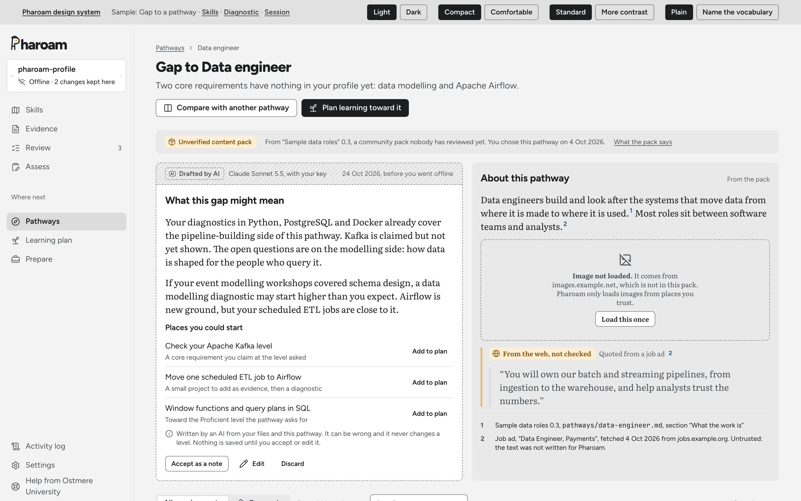
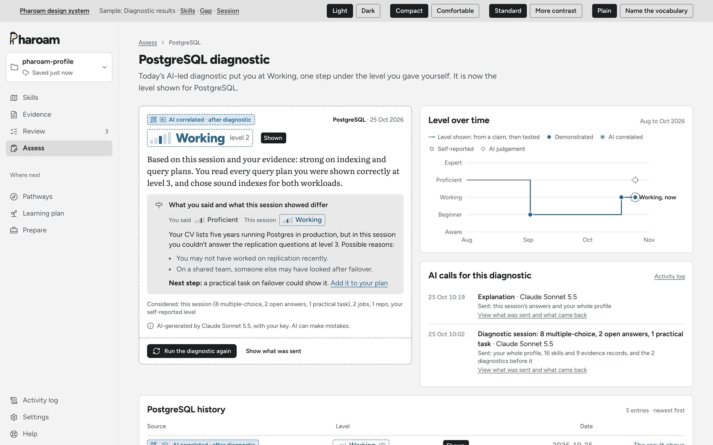
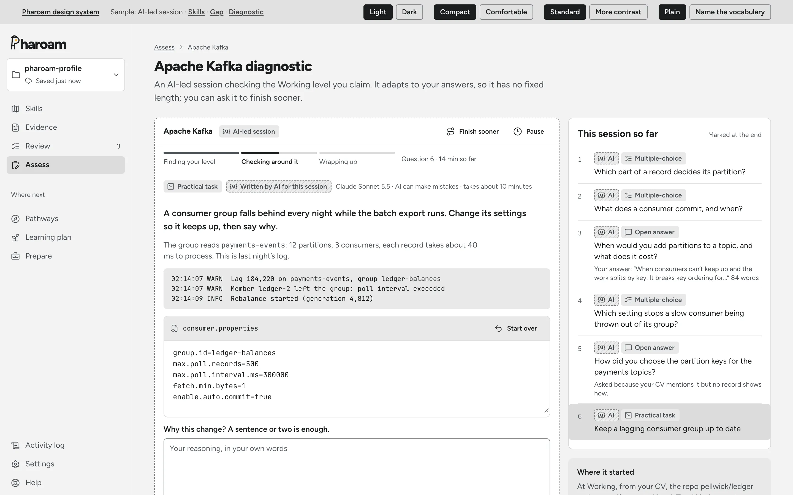
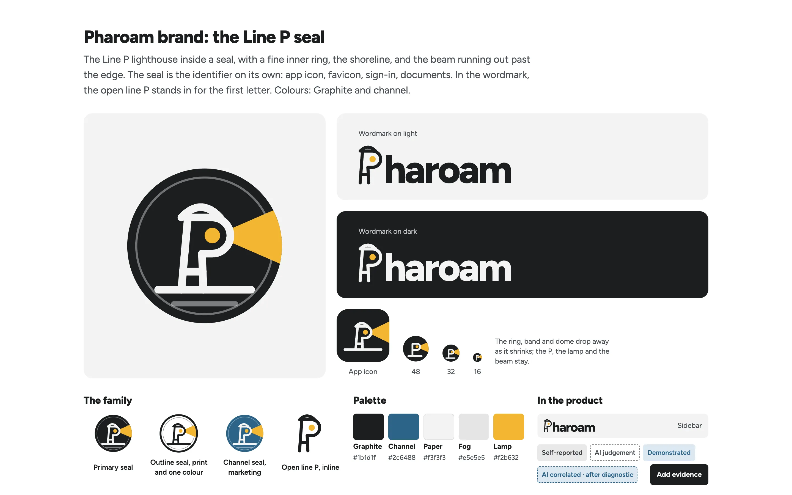

<div align="center">

<a href="https://pokaleo.github.io/Pharoam-Design-System/">
  <picture>
    <source media="(prefers-color-scheme: dark)" srcset="brand/wordmark-reversed.svg">
    
  </picture>
</a>

<h3>The lighthouse does not choose the road. It helps people see it.</h3>

<p>The visual language, domain vocabulary and components Pharoam is built from,<br>in light and dark, compact and comfortable.</p>

<p>
  <a href="https://pokaleo.github.io/Pharoam-Design-System/">
    <picture>
      <source media="(prefers-color-scheme: dark)" srcset="https://img.shields.io/badge/View_the_live_site_%E2%86%92-f3f3f3?style=for-the-badge">
      
    </picture>
  </a>
</p>

<p>
  
  
  
  <a href="LICENSE"></a>
</p>

<p>
  <a href="https://pokaleo.github.io/Pharoam-Design-System/"><b>Design system</b></a>
  &nbsp;·&nbsp;
  <a href="https://pokaleo.github.io/Pharoam-Design-System/samples/skills.html"><b>Skills overview</b></a>
  &nbsp;·&nbsp;
  <a href="https://pokaleo.github.io/Pharoam-Design-System/samples/gap.html"><b>Gap to a pathway</b></a>
  &nbsp;·&nbsp;
  <a href="https://pokaleo.github.io/Pharoam-Design-System/samples/diagnostic.html"><b>Diagnostic results</b></a>
  &nbsp;·&nbsp;
  <a href="https://pokaleo.github.io/Pharoam-Design-System/samples/session.html"><b>AI-led session</b></a>
  &nbsp;·&nbsp;
  <a href="https://pokaleo.github.io/Pharoam-Design-System/brand/"><b>Brand board</b></a>
</p>

<br>

<a href="https://pokaleo.github.io/Pharoam-Design-System/samples/skills.html">
  
</a>

</div>

<br>

## Highlights

<table>
  <tr>
    <td width="33%" valign="top">
      <h4>🌓 Two themes, two densities</h4>
      Light and dark, compact and comfortable, plus a more-contrast mode. Every page has switches for all of them.
    </td>
    <td width="33%" valign="top">
      <h4>♿ Accessible by default</h4>
      WCAG 2.2 AA in both themes and both densities is the floor, not a goal.
    </td>
    <td width="33%" valign="top">
      <h4>↔️ Ready for right to left</h4>
      English today. Components use logical properties throughout, so layouts mirror when a right-to-left language is added.
    </td>
  </tr>
  <tr>
    <td width="33%" valign="top">
      <h4>🧭 A domain vocabulary</h4>
      Sources, the one level shown, diagnostic results, gap groups, AI states, record states, save and sync, and trust markers, each shown in light and dark.
    </td>
    <td width="33%" valign="top">
      <h4>🤖 Honest AI</h4>
      Everything AI-made has a dashed edge, the AI monogram, the model's name and a disclaimer.
    </td>
    <td width="33%" valign="top">
      <h4>📦 Nothing from a third party</h4>
      Fonts and icons are self-hosted, with no CDNs: the pages work straight from the file system.
    </td>
  </tr>
</table>

## See it

<table>
  <tr>
    <td width="50%" valign="top">
      <a href="https://pokaleo.github.io/Pharoam-Design-System/">
        <picture>
          <source media="(prefers-color-scheme: dark)" srcset=".github/readme/index-dark.webp">
          
        </picture>
      </a>
      <p align="center"><b>The design system</b><br><sub>Identity, foundations, vocabulary, components, accessibility and voice</sub></p>
    </td>
    <td width="50%" valign="top">
      <a href="https://pokaleo.github.io/Pharoam-Design-System/samples/gap.html">
        <picture>
          <source media="(prefers-color-scheme: dark)" srcset=".github/readme/gap-dark.webp">
          
        </picture>
      </a>
      <p align="center"><b>Gap to a pathway</b><br><sub>A sample view showing the system applied</sub></p>
    </td>
  </tr>
  <tr>
    <td width="50%" valign="top">
      <a href="https://pokaleo.github.io/Pharoam-Design-System/samples/diagnostic.html">
        <picture>
          <source media="(prefers-color-scheme: dark)" srcset=".github/readme/diagnostic-dark.webp">
          
        </picture>
      </a>
      <p align="center"><b>Diagnostic results</b><br><sub>The latest result, the level over time, and a history where each entry opens</sub></p>
    </td>
    <td width="50%" valign="top">
      <a href="https://pokaleo.github.io/Pharoam-Design-System/samples/session.html">
        <picture>
          <source media="(prefers-color-scheme: dark)" srcset=".github/readme/session-dark.webp">
          
        </picture>
      </a>
      <p align="center"><b>AI-led session</b><br><sub>An adaptive session shown by phase, with no fixed length, and a way to finish sooner</sub></p>
    </td>
  </tr>
  <tr>
    <td colspan="2">
      <a href="https://pokaleo.github.io/Pharoam-Design-System/brand/">
        
      </a>
      <p align="center"><b>The brand board</b><br><sub>The Line P seal, wordmark, app icon and palette</sub></p>
    </td>
  </tr>
</table>

<sub>Screenshots follow your GitHub theme. Switch between light and dark to see both.</sub>

## Main decisions

<table>
  <tr>
    <td width="72" align="center" valign="top"></td>
    <td><b>Identity: the Line P seal.</b> A capital P drawn as a lighthouse in one even line sits in a seal with a beam running past the edge. In the wordmark the open line P is the first letter. See <a href="brand/"><code>brand/</code></a>.</td>
  </tr>
  <tr>
    <td align="center" valign="top">
      
    </td>
    <td><b>Colour: Graphite and channel.</b> Graphite is the brand and the one filled button; Channel blue is the one hue for tested levels, links and the main data; gold appears only in the seal and as a highlight. There is no green anywhere. Amber means "needs attention" and red means a real problem.</td>
  </tr>
  <tr>
    <td align="center" valign="top"><b>Aa</b></td>
    <td><b>Type.</b> Figtree for the interface and every title; Literata for long reading only.</td>
  </tr>
  <tr>
    <td align="center" valign="top"><b>0–4</b></td>
    <td><b>Levels.</b> Five named steps, Aware to Expert. The stair glyph lights only the step you are on, so it never reads as a meter. No scores, percentages or gauges.</td>
  </tr>
  <tr>
    <td align="center" valign="top"><b>1 of 4</b></td>
    <td><b>Sources.</b> Each skill shows one level, picked by a written order and never blended, with a line saying where it came from. There are four sources: two untested (self-reported, an AI judgement from your evidence) and two tested in a diagnostic (demonstrated in a question bank, AI correlated after an AI-led session). Only a tested level supports a pathway's requirement. Evidence is linked to skills and carries no level.</td>
  </tr>
  <tr>
    <td align="center" valign="top"><b>AI</b></td>
    <td><b>AI.</b> Everything AI-made has a dashed edge, the AI monogram, the model's name and a disclaimer. An AI-correlated result carries the same edge, so it never looks like a demonstrated one.</td>
  </tr>
</table>

## What is where

```text
.
├── index.html               Identity, foundations, domain vocabulary, components,
│                            organisation slots, accessibility and languages, voice
├── samples/
│   ├── skills.html          The skills overview
│   ├── gap.html             The gap to a pathway
│   ├── diagnostic.html      Diagnostic results and history for one skill
│   └── session.html         An AI-led diagnostic session in progress
├── brand/                   Seal, wordmark, line P, favicon, app icon, brand board; own LICENSE
├── assets/
│   ├── css/
│   │   ├── tokens.css       Every value: colour for both themes, type, density, shape, motion,
│   │   │                    more-contrast mode, and shadcn/ui variable names mapped onto Pharoam roles
│   │   ├── pharoam.css      Components, with logical properties so they mirror for right to left
│   │   └── doc.css          Layout of the document and sample frames only, not part of the product
│   ├── fonts/               Figtree, Literata, JetBrains Mono, Noto Arabic and Hebrew,
│   │                        each with its OFL.txt and SOURCE.md, rebuilt by subset.py
│   ├── icons/lucide/        Lucide icon sprite, with its licence (ISC and MIT)
│   └── js/glyphs.js         Our AI monogram (brand/marks.js has the seal and wordmark)
└── LICENSE, THIRD_PARTY_LICENSES.md, REUSE.toml, LICENSES/
                             What is ours, what is third-party, and the licence of every file
```

## Licence

> [!IMPORTANT]
> This design system is © 2026 The Pharoam authors, all rights reserved. It is public so people can see it, but it is **not open source**.
>
> - **Allowed:** viewing it and forking it on GitHub.
> - **Not allowed without our written permission:** using, copying, modifying or building on it, commercially or not.

See [`LICENSE`](LICENSE). The Pharoam name and brand assets are covered by [`brand/LICENSE`](brand/LICENSE). To ask for permission, start a [GitHub Discussion](https://github.com/pokaleo/Pharoam-Design-System/discussions) in this repository.

Only third-party fonts and icons are under other licences, listed in [`THIRD_PARTY_LICENSES.md`](THIRD_PARTY_LICENSES.md).

<details>
<summary><b>Adding a third-party asset</b></summary>

<br>

1. **Check the licence first.** It must let us bundle, self-host, modify and redistribute the asset, including commercially.
   - **Allowed:** `OFL-1.1` (fonts), `Apache-2.0`, `MIT`, `ISC`, `BSD-2-Clause`, `BSD-3-Clause`, `CC0-1.0`, `CC-BY-4.0` (images, with credit).
   - **Not allowed:** "free for personal use", freeware with unclear terms, any non-commercial or no-derivatives licence (`CC-BY-NC-*`, `CC-BY-ND-*`), and commercial licences. Ask before adding anything else.
2. **Get it from upstream:** the author's or foundry's own repository or release, never a download mirror or CDN.
3. **Check for a Reserved Font Name** in a font's OFL. If there is one, ship the font unmodified, or choose another font.
4. **Put it in its own folder** with its licence file and a `SOURCE.md` giving the upstream URL, version and download date:
   - fonts in `assets/fonts/<family>/`
   - icons in `assets/icons/<set>/`
   - images in `assets/images/<source>/`
5. **Subset or convert with the recorded script** (`assets/fonts/subset.py`), so the result can be reproduced.
6. **Add it to `REUSE.toml`** and to `THIRD_PARTY_LICENSES.md`.
7. **Don't load it from the network.** No Google Fonts, no CDNs, no remote images. Everything is served from this repository.

</details>

<details>
<summary><b>Adding our own asset</b></summary>

<br>

1. **Brand files** (name, seal, wordmark, and icons made from them) go in `brand/`.
2. **Everything else** goes where it belongs. It is covered by `LICENSE`.
3. **Record how it was made** in the commit message: by hand, from a template (which one), or with an AI tool (which one). Never use stock images or templates whose licence we can't check.

</details>

<br>

<div align="center">
  
  <br>
  <sub>© 2026 The Pharoam authors</sub>
</div>
